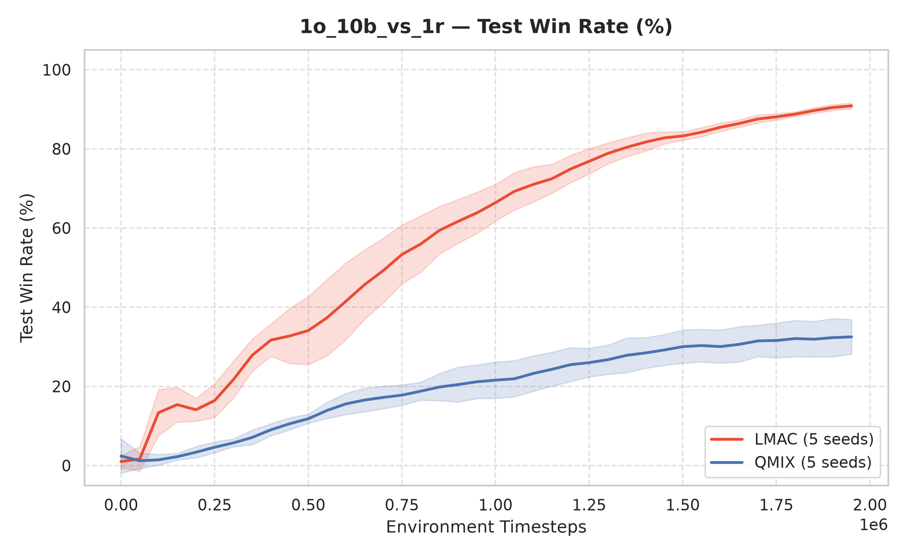
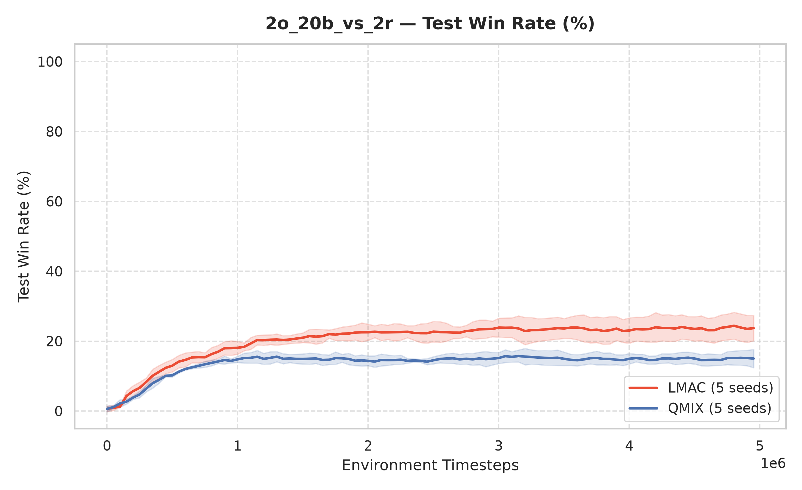
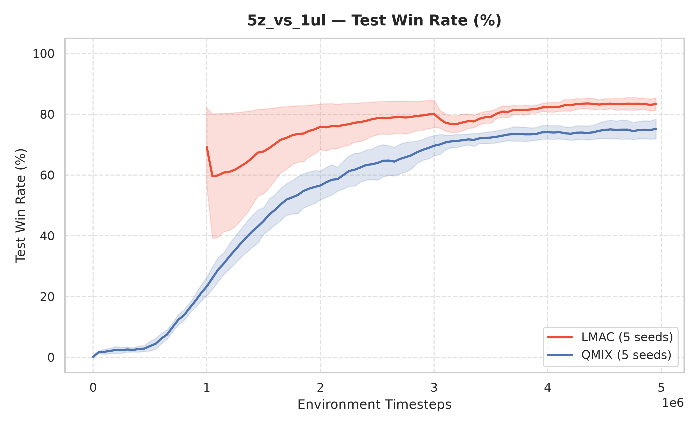
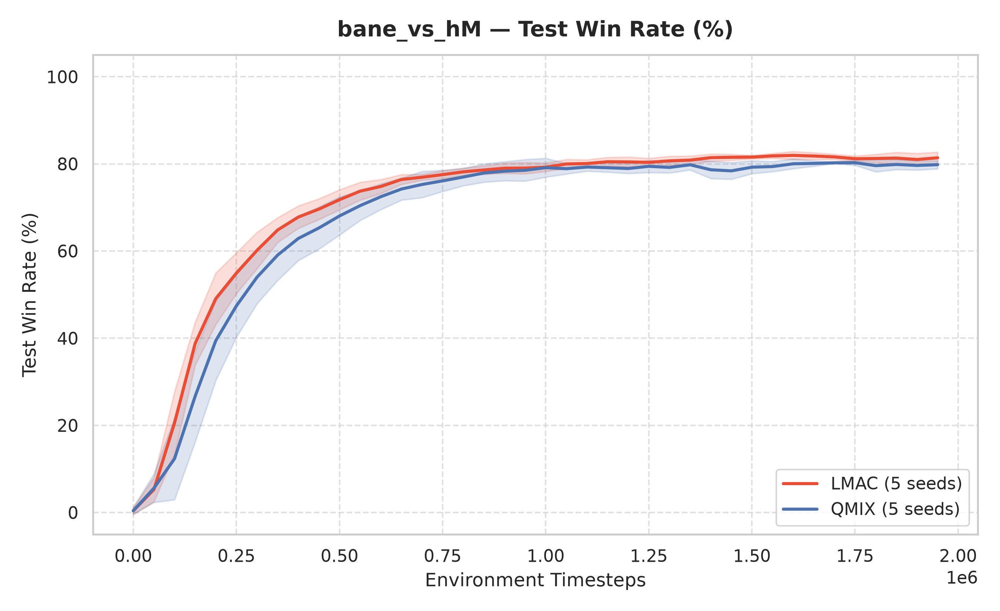
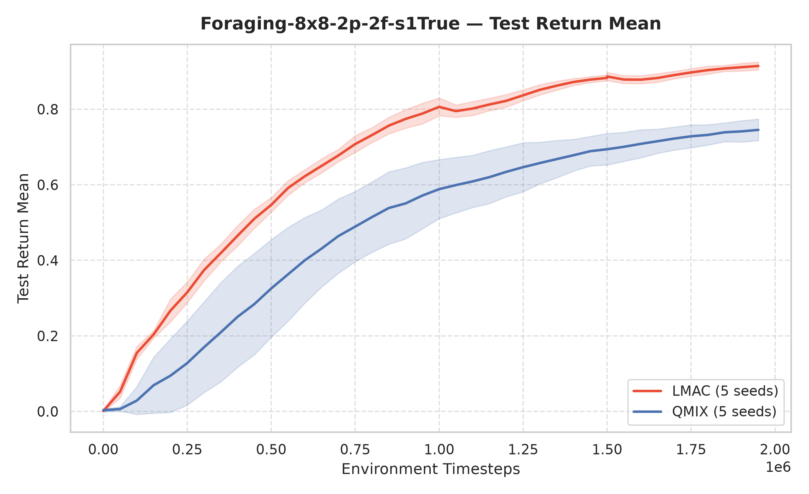
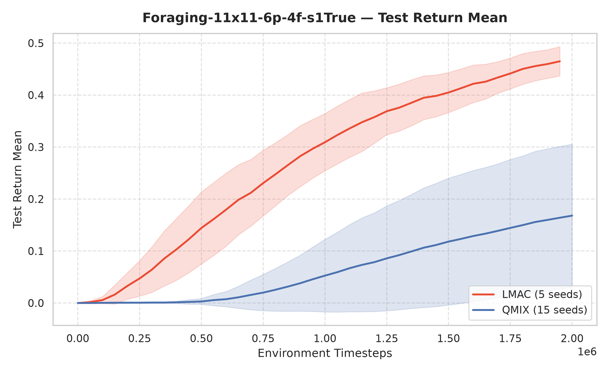
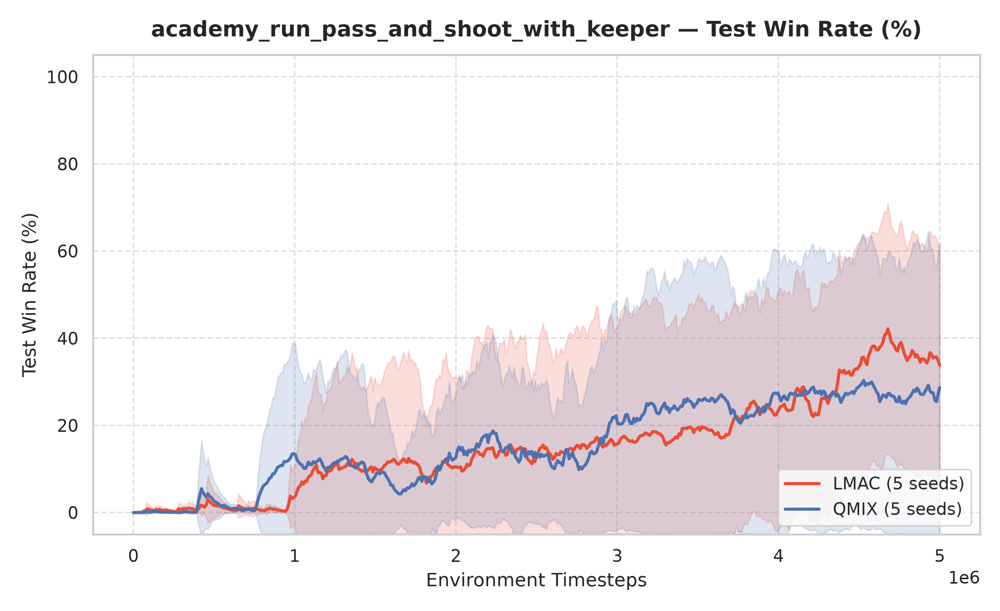

# Reproducing LMAC (LLM-Guided Communication for Cooperative MARL) with QMIX
As part of King’s Undergraduate Research Fellowship (KURF)

**Author:** Krishiv Agrawal (supervised by Dr. Stefanos Leonardos and Mr. Zihao Li | Faculty of Natural, Mathematical & Engineering Sciences, King's College London)
**Compute:** King's College London CREATE HPC cluster (Slurm)
**Status:** 7 of 8 benchmark environments in `exec/` have been run and plotted (`plots/`); `academy_3_vs_1_with_keeper` (3M timesteps) is prepared in `exec/academy_3_vs_1_with_keeper/` and will be updated once its cluster run finishes.

This repository is a **reproduction study** of *LMAC: LLM-Guided Communication for Cooperative Multi-Agent Reinforcement Learning* (Bae et al., ICML 2026), comparing LMAC against a QMIX baseline across StarCraft II (SMAC-Comm), Level-Based Foraging (LBF), and Google Research Football (GRF). It is built on the authors' released code, which extends [EPyMARL](https://github.com/uoe-agents/epymarl).

> **What is and isn't my work.** The LMAC method, the EPyMARL framework (`src/`), the pre-collected trajectory data, and the LLM-generated communication protocols (`src/llm_source_archive/`) are all **from the original authors**. I did not call an LLM API to regenerate protocols from scratch; I reused the released ones (adding the missing `imp_state_select.py` helper for `Foraging-11x11-6p-4f-s1True` derived from the authors' released `feedback_data_summary.json` and fixing a hardcoded tensor-expand dimension in `src/llm_source_archive/5z_vs_1ul/comm_update.py`). My contribution is the reproduction itself: the Slurm job scripts for every experiment (`exec/`), the cluster compilation and setup scripts (`compile_grf.sbatch`, Conda environments, and lockfiles), the Sacred results-aggregation and debiased-EMA plotting pipeline (`plot_results.py`), and the empirical evaluation against the paper.

---

## 1. Summary of results

Final values are the **mean ± std across seeds of the last 10 evaluation points** per seed (produced directly by `python plot_results.py`). Paper reference values are taken from Figure 5 of the LMAC paper / project page (`docs/static/images/performance.png`).

| Environment | Metric | QMIX (mine) | LMAC (mine) | QMIX (paper) | LMAC (paper) | Reproduced? |
|---|---|---|---|---|---|---|
| `1o_10b_vs_1r` | Test win rate (%) | 33.16 ± 4.52% | **92.04 ± 1.05%** | ~41% | ~96% | **Yes** — large +59% gain over QMIX matches paper |
| `2o_20b_vs_2r` | Test win rate (%) | 14.78 ± 2.71% | **23.68 ± 4.01%** | ~25% | ~71% | **Partial** — LMAC beats QMIX (+8.9%), but both plateau below paper (see Section 7) |
| `5z_vs_1ul` | Test win rate (%) | 74.74 ± 3.45% | **83.00 ± 2.45%** | ~78% | ~88% | **Yes** — matches paper trajectory and final win rate |
| `bane_vs_hM` | Test win rate (%) | 80.62 ± 1.31% | **81.42 ± 1.34%** | ~20% | ~73% | **LMAC Yes / QMIX higher** — see `sight_range` note in Section 7 |
| `Foraging-8x8-2p-2f-s1True` | Test return (norm.) | 0.75 ± 0.03 | **0.91 ± 0.01** | ~0.83 | ~0.94 | **Yes** — closely matches paper |
| `Foraging-11x11-6p-4f-s1True` | Test return (norm.) | 0.17 ± 0.14 (15 seeds)<br>0.06 ± 0.10 (seeds 1–5) | **0.47 ± 0.03** | ~0.42 | ~0.50 | **Yes** — LMAC matches paper (~0.50) with much lower variance than QMIX |
| `academy_3_vs_1_with_keeper` | Test win rate (%)<br>*(3M timesteps)* | *Pending (to be run)* | *Pending (to be run)* | ~41% | ~64% | *In progress* — scripts ready in `exec/academy_3_vs_1_with_keeper/`; will update upon completion |
| `academy_run_pass_and_shoot_with_keeper` | Test win rate (%)<br>*(Test return)* | 28.25 ± 33.40%<br>*(27.55 ± 33.73)* | **35.00 ± 27.63%**<br>*(34.59 ± 27.67)* | ~31% | ~65% | **Partial** — LMAC outperforms QMIX on average, with high bimodal seed variance (up to 76.25%) |

**Overall takeaway:** The paper's core claim holds across all seven completed environments: **LMAC consistently outperforms QMIX**, with its largest and most reliable gains in partially observable tasks where unshared observations bottleneck coordination (`1o_10b_vs_1r`, both Level-Based Foraging tasks, and `5z_vs_1ul`). Where absolute numbers differ from the paper (`2o_20b_vs_2r`, QMIX on `bane_vs_hM`, and seed variance on GRF), inspecting the codebase and Sacred configs reveals concrete technical causes documented in Section 7. The remaining GRF scenario (`academy_3_vs_1_with_keeper`, $t_{\max} = 3\text{M}$ timesteps, evaluated via Test Win Rate % / `test_score_reward_mean`) is configured in `exec/academy_3_vs_1_with_keeper/` and this table and `plots/` will be updated once its cluster run completes.

### Learning curves (`plots/`)

| StarCraft II (`SMAC-Comm`) | |
|---|---|
|  |  |
|  |  |

| Level-Based Foraging (`LBF`) & Google Research Football (`GRF`) | |
|---|---|
|  |  |
|  | **`academy_3_vs_1_with_keeper`** (`t_max = 3,000,000`, Test Win Rate %)<br>*Plot (`plots/academy_3_vs_1_with_keeper_test_score_reward_mean.png`) will be added once the 3M-timestep runs in `exec/academy_3_vs_1_with_keeper/` finish.* |

---

## 2. Repository layout

```
.
├── src/                  Training code (EPyMARL + LMAC, from the original authors)
│   ├── main.py, run.py                 Entry point and training loop for baselines (QMIX)
│   ├── main_llm_final.py, run_llm_final.py   Entry point and training loop for LMAC
│   ├── llm_final.py                    End-to-end LLM protocol generation + refinement pipeline
│   ├── LLM/                            LLM prompt templates, code loader, and API wrappers
│   └── llm_source_archive/             Pre-generated communication protocols per environment
├── exec/                 Canonical Slurm job scripts, one folder per environment (Section 5)
│   ├── 1o_10b_vs_1r/                   run_lmac_1o.sbatch, run_qmix_1o.sbatch
│   ├── 2o_20b_vs_2r/                   run_lmac_2o.sbatch, run_qmix_2o.sbatch
│   ├── 5z_vs_1ul/                      run_lmac_5z.sbatch, run_qmix_5z.sbatch
│   ├── bane_vs_hM/                     run_lmac_bane.sbatch, run_qmix_bane.sbatch
│   ├── Foraging-8x8-2p-2f-s1True/      run_lmac_foraging8x8.sbatch, run_qmix_foraging8x8.sbatch
│   ├── Foraging-11x11-6p-4f-s1True/    run_lmac_foraging11x11.sbatch, run_qmix_foraging11x11.sbatch
│   ├── academy_3_vs_1_with_keeper/     run_lmac_3_vs_1.sbatch, run_qmix_3_vs_1.sbatch
│   ├── academy_run_pass_and_shoot_with_keeper/  run_lmac_run_pass_and_shoot.sbatch, run_qmix_run_pass_and_shoot.sbatch
│   └── _archive/                       One-off checkpoint resume, node-retry, and extra-seed scripts
├── results/sacred/       Tracked Sacred config.json and metrics.json for all baseline & LMAC runs
├── plot_results.py       Turns raw Sacred output into figures + summary table
├── plots/                Final figures (one clean plot per environment)
├── sc2_maps/             Custom StarCraft II maps (.SC2Map)
├── grf_maps/             Custom Google Research Football scenarios (.py)
├── install_sc2.sh        Installs StarCraft II (v4.10) and base SMAC maps
├── compile_grf.sbatch    Slurm job that compiles Google Research Football from source
├── clean.sh              Cluster helper to kill running Python jobs (see warning in Section 7)
├── requirements.txt, env_requirements.txt, requirements-lock*.txt, environment-*.yml   Dependencies (Section 3)
├── docker/               From upstream EPyMARL; not used in this study
├── docs/                 Upstream LMAC ICML 2026 project web page (static HTML)
│
│   Ignored by git (too large / machine-specific):
├── data/                 Authors' pre-collected trajectories (.pkl)
├── results/models/       Saved PyTorch checkpoints
├── results/sacred/**/cout.txt, info.json, run.json, _sources/
├── logs/, wandb/, 3rdparty/
```

---

## 3. Installation and Conda environments

Everything ran on Linux (King's CREATE HPC) with Python 3.9.25 and PyTorch 2.8.0 (CUDA 12.8 wheels). Three Conda environments are used, because Google Research Football (GRF) needs different package pins (`numpy<2`, `protobuf==3.20.3`, `gym==0.25.2`) and system libraries (`boost`, `SDL2`) from the SC2 / Foraging experiments:

| Environment | Used for | Key versions | Created from |
|---|---|---|---|
| `epymarl-llm` | Training on SC2 and Level-Based Foraging; plotting | Python 3.9.25, torch 2.8.0, numpy 2.0.2, gym 0.26.2, protobuf 6.33.6, sacred 0.8.7, pysc2 3.0.0 | `environment-epymarl-llm.yml` / `requirements-lock.txt` |
| `epymarl_gfootball` | Training on Google Research Football | Python 3.9.25, torch 2.8.0, gfootball 2.10.2, numpy 1.26.4, gym 0.25.2, protobuf 3.20.3, boost 1.85, SDL2 | `environment-epymarl_gfootball.yml` + `requirements-lock-gfootball.txt` |
| `grf_cc` | Compiling GRF only (`compile_grf.sbatch`) | gcc/g++ 12.4, binutils 2.46, sysroot_linux-64 2.17 (no Python packages) | `environment-grf_cc.yml` |

Verified across all canonical `exec/*/*.sbatch` scripts (`grep -h "conda activate" exec/*/*.sbatch | sort | uniq -c`):
- `12 conda activate epymarl-llm` (all 6 SMAC and Level-Based Foraging environments, both LMAC and QMIX)
- `4 conda activate epymarl_gfootball` (`academy_3_vs_1_with_keeper` and `academy_run_pass_and_shoot_with_keeper`, both LMAC and QMIX)

### Create the environments

```bash
git clone https://github.com/Krishivagrawal2007/reproducing-lmac-qmix.git
cd reproducing-lmac-qmix

# 1) SC2 + Foraging + Plotting
conda create -n epymarl-llm python=3.9 -y
conda activate epymarl-llm
pip install -r requirements-lock.txt

# 2) GRF training + compilation toolchain
conda env create -f environment-epymarl_gfootball.yml
conda activate epymarl_gfootball
pip install -r requirements-lock-gfootball.txt
conda env create -f environment-grf_cc.yml
```

SMAC, SMACv2, smaclite, and matrix-games are installed from GitHub at pinned commits (listed in `requirements-lock.txt`). Do not install `smac` from PyPI: the PyPI package named `smac` is an unrelated library (Sequential Model-based Algorithm Configuration).

### StarCraft II

`install_sc2.sh` installs StarCraft II (Linux v4.10) into `3rdparty/StarCraftII` and downloads standard SMAC maps into `3rdparty/StarCraftII/Maps/SMAC_Maps/`. Afterward, copy the custom SMAC-Comm maps from `sc2_maps/` into `SMAC_Maps/`:

```bash
bash install_sc2.sh
export SC2PATH="$PWD/3rdparty/StarCraftII"
cp sc2_maps/*.SC2Map "$SC2PATH/Maps/SMAC_Maps/"
```

### Google Research Football

```bash
sbatch compile_grf.sbatch
```
`compile_grf.sbatch` activates `epymarl_gfootball`, uses the GCC 12.4 toolchain from `grf_cc` with `sysroot_linux-64=2.17` so the compiled `_gameplayfootball.so` C++ engine is compatible with the host's `glibc` across all cluster nodes, and runs a headless preflight test. Edit the `#SBATCH` lines at the top of the script if needed for your cluster.

### Python package files

| File | Purpose |
|---|---|
| `requirements.txt`, `env_requirements.txt` | Upstream readable lists of core and environment dependencies. |
| `requirements-lock.txt` | Exact `pip freeze` of `epymarl-llm` when the results were produced (includes pinned GitHub commits for `SMAC`, `SMACv2`, `smaclite`, and `matrixgames`). |
| `requirements-lock-gfootball.txt` | Exact pip package pins for `epymarl_gfootball`. |
| `environment-epymarl-llm.yml`, `environment-epymarl_gfootball.yml`, `environment-grf_cc.yml` | Full Conda environment specifications. |

**Note on `wandb` and `protobuf`:** the LMAC entry point (`src/run_llm_final.py`) originally imported `wandb` unconditionally, although logging is off by default (`use_wandb: False` in `src/config/default.yaml`). In `epymarl_gfootball`, `wandb` cannot simply be installed because Google Research Football requires `protobuf==3.20.3`, whereas recent `wandb` releases require `protobuf>=4`. The import in `src/run_llm_final.py` is therefore guarded with `try: import wandb except ImportError: wandb = None`, allowing LMAC to run in `epymarl_gfootball` without `wandb`.

### API keys

**No API keys or environment variables are needed to run or reproduce this work.**
- In `src/config/algs/lmac.yaml`, `openai_key`, `gemini_key`, and `claude_key` default to the placeholder string `"..."`.
- When `src/run_llm_final.py` instantiates `Communication(args, None)` to load the communication protocol modules via `CodeUtils.import_and_reload_module()`, `Anthropic(api_key=self.args.claude_key)` and `OpenAI(api_key=self.args.openai_key)` accept the `"..."` placeholder string at construction time without making network requests or validating credentials. `google.generativeai.configure(...)` is only called inside `_call_llm()`.
- Thus, neither `OPENAI_API_KEY`, `ANTHROPIC_API_KEY`, nor `GEMINI_API_KEY` needs to be exported unless you run the LLM protocol-generation pipeline (`src/llm_final.py`). Weights & Biases logging is disabled by default (`use_wandb: False`).

---

## 4. Data and Pre-Generated Protocols

All LLM-generated communication protocols and state-selection functions released by the LMAC authors are **included directly in this repository** under `src/llm_source_archive/<environment>/`:
- `imp_state_select.py`: defines `select_important_state()`, returning the list of global state indices `important_state` that the meta-cognitive discriminator/encoder reconstructs.
- `comm_init.py`: initial communication protocol ($k=0$) defining `communication(o)` for single-step observations `(B, N, obs_dim)`.
- `comm_update.py`: step-1 refined communication protocol ($k=1$, recovery enhancement) defining `communication(o)` for `(B, N, obs_dim)`.
- `comm_update_timestep_wise2.py`: step-2 refined communication protocol ($k=2$, inter-agent imbalance mitigation with temporal context) defining `communication(o)` for 10-step observation windows `(B, 10, N, obs_dim)`.

Offline trajectory buffers (`data/<map_name>/*.pkl`) are only required if you run `src/llm_final.py` to train the standalone phase-0/phase-1 discriminators for LLM feedback generation; they are **not** required for MARL training via `src/main_llm_final.py` or `src/main.py`.

---

## 5. Running experiments

Each environment has a folder in `exec/` containing two canonical Slurm array scripts (`run_lmac_*.sbatch` and `run_qmix_*.sbatch`); the Slurm array task ID (`1-5`) is passed as `seed=$SEED`.

| Environment | Domain | Conda env | `t_max` (env steps) | Seeds |
|---|---|---|---|---|
| `1o_10b_vs_1r` | StarCraft II | `epymarl-llm` | 2,000,000 | 1–5 |
| `bane_vs_hM` | StarCraft II | `epymarl-llm` | 2,000,000 | 1–5 |
| `2o_20b_vs_2r` | StarCraft II | `epymarl-llm` | 5,000,000 | 1–5 |
| `5z_vs_1ul` | StarCraft II | `epymarl-llm` | 5,000,000 | 1–5 |
| `Foraging-8x8-2p-2f-s1True` | Level-Based Foraging | `epymarl-llm` | 2,000,000 | 1–5 |
| `Foraging-11x11-6p-4f-s1True` | Level-Based Foraging | `epymarl-llm` | 2,000,000 | 1–5 (QMIX: 1–15 tracked) |
| `academy_3_vs_1_with_keeper` | Google Research Football | `epymarl_gfootball` | 3,000,000 | 1–5 *(to be run)* |
| `academy_run_pass_and_shoot_with_keeper` | Google Research Football | `epymarl_gfootball` | 5,000,000 | 1–5 |

**Always submit from the repository root.** All `#SBATCH --output=logs/<env>/<alg>/...` paths are relative to the working directory from which `sbatch` is invoked, and Slurm will fail immediately if the target `logs/` subdirectory does not exist:

```bash
cd <repo root>
for d in exec/*/; do
    e=$(basename "$d")
    [ "$e" = "_archive" ] && continue
    mkdir -p "logs/$e/lmac" "logs/$e/qmix"
done

sbatch exec/1o_10b_vs_1r/run_lmac_1o.sbatch
sbatch exec/1o_10b_vs_1r/run_qmix_1o.sbatch
```

### Interrupted, resumed, retry, and extra-seed runs (`exec/_archive/`)

During the cluster reproduction, several long jobs hit Slurm wall-time limits or landed on a faulty GPU node. The one-off recovery scripts are archived in `exec/_archive/` (with full details in `exec/_archive/README.md`):

- **Wall-time continuations (`*resume*`, `*continue*`):** LMAC runs on `5z_vs_1ul`, seed 1 of `2o_20b_vs_2r`, and `Foraging-8x8-2p-2f-s1True` exceeded the initial 12h wall-time limit and were resumed from their last checkpoint in `results/models/`. Each continuation creates a new Sacred run directory; `plot_results.py` automatically stitches all segments for a given `(env, alg, seed)` in chronological order.
- **Node retries (`*retry*`):** Initial array jobs on `2o_20b_vs_2r` failed at startup when scheduled onto cluster node `erc-hpc-comp040`, whose GPU driver was in a wedged state (`torch.AcceleratorError: CUDA error: CUDA-capable device(s) is/are busy or unavailable`). The retry scripts resubmit with `#SBATCH --exclude=erc-hpc-comp040`.
- **Extra QMIX seeds (`run_qmix_foraging11x11_extraseeds.sbatch`):** Runs QMIX seeds 6–15 on `Foraging-11x11-6p-4f-s1True` (`sight=1`, `force_coop=True`) to evaluate exploration variance on the 6-agent cooperative foraging task.
- **TF32 / cuBLAS fix on `2o_20b_vs_2r`:** On NVIDIA A100 GPUs (CUDA 12.8 / PyTorch 2.8), both LMAC and QMIX initially crashed around $t_{\text{env}} \approx 50$ on `2o_20b_vs_2r` (22 agents, the largest tensor shapes in this study) with `RuntimeError: CUDA error: CUBLAS_STATUS_EXECUTION_FAILED when calling cublasSgemm`. Disabling TF32 tensor-core kernel selection at the driver level (`export NVIDIA_TF32_OVERRIDE=0` and `export CUBLAS_WORKSPACE_CONFIG=:4096:8`) in `exec/2o_20b_vs_2r/run_lmac_2o.sbatch` and `run_qmix_2o.sbatch` forces standard FP32 cuBLAS GEMM kernels and completely resolved the crash without altering any model architecture or training hyperparameters.

---

## 6. Results, Plotting, and Extending with a New Communication Protocol

### Where raw results are stored

Sacred writes each run to:

```
results/sacred/<ALGORITHM>/<environment>/<run_id>/
    config.json     exact configuration of that run (algorithm, map/key, seed, hyperparameters)
    metrics.json    logged metrics: for each metric, lists of "steps" and "values"
```

Both `config.json` and `metrics.json` for every valid run are **tracked in Git** (95 Sacred run folders across the 7 environments), while `cout.txt`, `info.json`, `run.json`, `_sources/`, and `results/models/` are git-ignored. Supervisors and collaborators can therefore re-plot all baselines immediately after cloning without re-running any experiments.

### Producing the plots

```bash
conda activate epymarl-llm
python plot_results.py --expected-seeds 1 2 3 4 5 --overwrite          # regenerate all 7 canonical plots in plots/
python plot_results.py --seeds 1 2 3 4 5 --expected-seeds 1 2 3 4 5    # restrict Foraging-11x11 QMIX to seeds 1-5 only
python plot_results.py --envs 5z_vs_1ul --algs LMAC QMIX               # plot a subset of environments/algorithms
python plot_results.py --envs academy_run_pass_and_shoot_with_keeper --metrics test_return_mean
```

What `plot_results.py` does:
- Walks `results/sacred/`, reading `alg`, `env` (`env_args.map_name` or `env_args.key`), and `seed` from each run's `config.json`.
- In default (`auto`) metric mode, selects one primary evaluation metric per environment so every environment produces one plot:
  1. `test_battle_won_mean` (SMAC environments — Test Win Rate %),
  2. `test_score_reward_mean` (Google Research Football — Test Win Rate %, i.e. fraction of test episodes where the team scores),
  3. `test_return_mean` (Level-Based Foraging — normalised Test Return).
- Stitches multi-part resumed runs for the same `(env, alg, seed)` chronologically, replacing any post-checkpoint tail from the interrupted run with the continuation's data.
- Interpolates seeds onto a common step axis, applies TensorBoard-style debiased EMA smoothing (`--smooth-weight 0.85`), plots the mean ± 1 std across seeds, and prints the summary table (mean ± std and min–max of the last 10 evaluations per seed).

### How to plug in and plot a new communication protocol

To build and benchmark a new communication protocol or algorithm on top of these baselines:

1. **Implement the protocol module(s) (if using the LMAC architecture):**
   Create a directory such as `src/llm_source_archive/<env_name>_myproto/` containing:
   - `imp_state_select.py` with `select_important_state() -> list[int]` returning the target state indices.
   - One or more communication modules:
     - `comm_init.py` (and optionally `comm_update.py`): must define `communication(o: torch.Tensor) -> torch.Tensor`, taking agent observations `o` of shape `(B, n_agents, obs_dim)` (where `obs_dim = raw_obs + n_agents + n_actions`) and returning `torch.cat([o, messages], dim=-1)` of shape `(B, n_agents, obs_dim + msg_dim)`.
     - `comm_update_timestep_wise2.py` (when `timestep_wise=True`): must define `communication(o: torch.Tensor) -> torch.Tensor`, taking a 10-step observation history `o` of shape `(B, 10, n_agents, obs_dim)` and returning shape `(B, n_agents, obs_dim + msg_dim_timewise)`.
   `src/run_llm_final.py` automatically infers `message_dim` at startup by passing a dummy tensor through `communication(test_obs)`.

2. **Tag your algorithm name for Sacred and `plot_results.py`:**
   `plot_results.py` groups curves by the `name` field in Sacred's `config.json` (which also determines the subfolder under `results/sacred/<name>/<env>/`). Pass `name=MY_PROTO` in the Sacred `with` clause of your `.sbatch` script (or create `src/config/algs/my_proto.yaml` with `name: "MY_PROTO"`):
   ```bash
   python src/main_llm_final.py --config=lmac --env-config=sc2 with \
       name=MY_PROTO \
       env_args.map_name=1o_10b_vs_1r \
       t_max=2000000 seed=$SEED \
       timestep_wise=True \
       "comm_code_paths=['src/llm_source_archive/1o_10b_vs_1r_myproto/comm_init.py','src/llm_source_archive/1o_10b_vs_1r_myproto/comm_update.py','src/llm_source_archive/1o_10b_vs_1r_myproto/comm_update_timestep_wise2.py']" \
       "important_state=[62, 63, 67, 68]"
   ```
   *(If implementing a completely new MAC/Learner instead of plugging Python protocol files into LMAC, register them in `src/controllers/__init__.py` and `src/learners/__init__.py` and run via `src/main.py --config=my_proto`.)*

3. **Plot against the tracked LMAC and QMIX baselines:**
   Once Sacred writes to `results/sacred/MY_PROTO/<env>/<run_id>/`, run:
   ```bash
   python plot_results.py --envs 1o_10b_vs_1r --algs LMAC QMIX MY_PROTO --overwrite
   ```
   `plot_results.py` automatically assigns a distinct colour from `tab10` to any new algorithm name (or you can add a custom hex colour to `DEFAULT_COLOR_MAP` at the top of `plot_results.py`) and includes it in both the figure and the console summary table alongside `LMAC` and `QMIX`.

---

## 7. Known limitations, deviations, and technical notes

1. **`2o_20b_vs_2r` plateau (~23.7% LMAC vs. ~71% paper) and `5z_vs_1ul` regex quirk:**
   - In the initial submission scripts for `2o_20b_vs_2r` and `5z_vs_1ul`, `IMP_STATE` was extracted from `imp_state_select.py` using a regex one-liner (`re.search(r'\[.*?\]', open(...).read())`) instead of importing and calling `select_important_state()`. Because both files contain bracketed indices inside their docstrings (`s[133]` in `2o_20b_vs_2r/imp_state_select.py` and `s[2]` in `5z_vs_1ul/imp_state_select.py`), the regex extracted `important_state=[133]` (1 of 8 target dims) on `2o_20b_vs_2r` and `important_state=[2]` (1 of 28 target dims) on `5z_vs_1ul` (visible in `results/sacred/LMAC/{2o_20b_vs_2r,5z_vs_1ul}/*/config.json`).
   - On `5z_vs_1ul`, LMAC still reached **83.00 ± 2.45%** (matching the paper's ~88%). On `2o_20b_vs_2r`, supervising the meta-network on only a single coordinate (`Enemy1 X`) instead of both Roaches' and both Overseers' `(X, Y)` coordinates (`[133, 134, 138, 139, 122, 123, 128, 129]`) degraded state reconstruction. The canonical scripts `exec/2o_20b_vs_2r/run_lmac_2o.sbatch` and `exec/5z_vs_1ul/run_lmac_5z.sbatch` have been fixed to call `select_important_state()` directly (matching the Foraging and GRF scripts).
   - Additionally, in `src/config/envs/sc2.yaml`, `obs_last_action` is `False` by default, so SMAC environment observations have 156 features (`156 + 22 + 8 = 186` agent input dims on `2o_20b_vs_2r`), whereas the LLM-generated `src/llm_source_archive/2o_20b_vs_2r/comm_init.py` indexes `o[..., 178:200]` assuming `obs_last_action: True` (200 dims). On PyTorch this slice returns a 8-dim partial vector (`178:186`) without raising an `IndexError`.

2. **QMIX on `bane_vs_hM` (80.62% mine vs. ~20% paper):**
   - In `src/config/envs/sc2.yaml`, `sight_range` is set to `9` (the standard SMAC sight range) and passed to `StarCraft2Env`. With `sight_range=9`, the Banelings can directly spot the enemy Marines without relying exclusively on the Medivac/Zergling scout, allowing standard QMIX to reach 80.62 ± 1.31% while LMAC reaches 81.42 ± 1.34% and learns faster over the first 0.5M steps.

3. **`5z_vs_1ul` early learning curve ($0\text{--}1\text{M}$ steps):**
   - When the `5z_vs_1ul` LMAC jobs timed out and were resumed, the initial `results/sacred/LMAC/5z_vs_1ul/` run folders from the first segment ($0\text{--}1\text{M}$ steps) were overwritten/cleaned before the continuation runs (`1`–`5`, starting from the 1M and 3M checkpoints) were copied from the cluster, and LMAC seed 3 timed out at $4.15\text{M}$ steps (80.8% win rate). Final performance at $5\text{M}$ steps (83.00 ± 2.45%) is unaffected, and `plot_results.py` interpolates smoothly across the available checkpoints.

4. **`academy_run_pass_and_shoot_with_keeper` seed bimodality:**
   - Sparse-reward Google Research Football (`rewards='scoring'`) exhibits strong bimodal exploration variance across random seeds: LMAC seeds 2, 3, and 5 learn effective pass-and-shoot policies (reaching 76.25%, 54.38%, and 31.87% scoring rates), whereas seed 4 never discovers a scoring trajectory (0.00%). QMIX shows the same bimodality (seeds 3 and 4 reach 65.62% and 72.50%, while seeds 1, 2, and 5 remain at 0–2.5%).

5. **What checkpoints save (`results/models/`):**
   - Checkpoints are saved every `save_model_interval = 500000` timesteps to `results/models/<unique_token>/<t_env>/`.
   - **QMIX (`src/learners/q_learner.py` & `src/controllers/basic_controller.py`):** saves `agent.th` (policy network weights), `mixer.th` (QMIX mixing network weights), and `opt.th` (RMSprop/Adam optimiser state). Upon reload, `target_mac` and `target_mixer` are initialised from `agent.th` and `mixer.th`.
   - **LMAC (`src/learners/lmac_learner.py` & `src/controllers/lmac_controller.py`):** saves `agent.th` (policy network weights), `meta.th` (meta-cognitive message encoder/decoder `Msg_Converter` + `Discriminator_net` weights), `mixer.th` (QMIX mixer weights), and `opt.th` (joint optimiser state).
   - **Not saved in checkpoints:** the experience replay buffer (`ReplayBuffer`), the $\epsilon$-greedy exploration schedule step counter (which re-anneals over `epsilon_anneal_time = 50000` steps from `runner.t_env`), and Python/NumPy/PyTorch RNG states. Consequently, a run resumed from a checkpoint is not bit-for-bit identical to an uninterrupted run and exhibits a brief exploration dip for ~50k steps immediately after resuming.

6. **Warning on `clean.sh`:**
   - `clean.sh` is for dedicated cluster node cleanup only. It runs `pkill -u $(whoami) python`, which terminates **all** Python processes belonging to your user, and `./clean.sh all` deletes `results/sacred`. Do not run it on a shared login node or personal workstation.

---

## Acknowledgements and citation

- **LMAC** (method, code, data, protocols): <https://saaangjun.github.io/LMAC/> / <https://github.com/SaaangJun/LMAC>
  ```bibtex
  @inproceedings{bae2026lmac,
    title     = {LLM-Guided Communication for Cooperative Multi-Agent Reinforcement Learning},
    author    = {Sangjun Bae and Yisak Park and Sanghyeon Lee and Seungyul Han},
    booktitle = {Proceedings of the 43rd International Conference on Machine Learning (ICML)},
    year      = {2026}
  }
  ```
- **EPyMARL**: <https://github.com/uoe-agents/epymarl>
- **SMAC / SMACv2**: <https://github.com/oxwhirl/smac>, <https://github.com/oxwhirl/smacv2>
- **Level-Based Foraging**: <https://github.com/semitable/lb-foraging>
- **Google Research Football**: <https://github.com/google-research/football>
- **Compute**: King's College London CREATE HPC.
- **Supervisors**: Dr. Stefanos Leonardos and Mr. Zihao Li (Department of Informatics, Faculty of Natural, Mathematical & Engineering Sciences, King's College London), supported by the King's Undergraduate Research Fellowship (KURF).

## License

Apache-2.0, inherited from the upstream code. See `LICENSE` and `NOTICE`.
